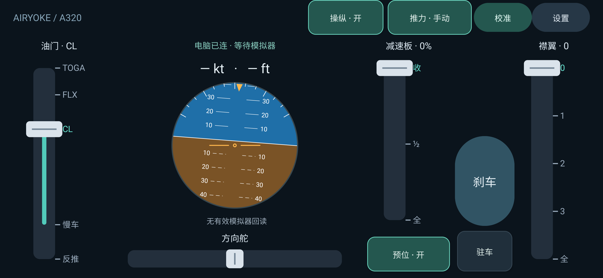

# AirYoke

AirYoke 将安卓手机变成微软模拟飞行的有线体感操纵器。手机负责采集姿态和触控输入，Windows 桥接程序通过 SimConnect 把操纵量发送给模拟器。



当前发布版本为 **1.5.1**，油门适配目标为 **MSFS 2020 的 iniBuilds A320neo V2 与 FlyByWire A32NX 稳定版**。游戏内最终验收尚未完成。

## 功能

- 手机倾斜控制副翼和升降舵，支持一键校准及轴向反转。
- 大尺寸油门杆，带反推、慢车、CL、FLX 和 TOGA 卡位。
- 油门手动接管与交还，交还时发送 CL 目标后停止覆盖飞机油门。
- 手机可选择机模；双杆标记分别显示座舱杆位，双发 N1 单独显示，橙色细线表示操作目标。
- 油门按飞机 EFB 双轴校准映射；错误机模、缺失校准和过期反馈禁止接管。
- TCP 遥测保留半包并处理粘包，手机仅接受当前通道的新序号，避免旧回读覆盖新值。
- 一键断开自动驾驶，只发送关闭指令并等待回读确认，重复点击不会接通。
- 方向舵松手自动回中。
- 连续减速板、减速板预位、五档襟翼、双轮刹车和驻车刹车。
- 回传空速、高度、自动驾驶、自动油门、襟翼及减速板状态。
- 优先使用 USB 网络共享的 UDP 通道；不可用时自动回退到 `adb reverse` TCP 通道。
- 500 毫秒断线保护，自动释放反推、刹车和三个姿态操纵轴。
- 内置协议与控制输出自检，以及不会驱动飞机的空转诊断模式。

## 使用要求

- Windows 10 或 Windows 11，64 位。
- Microsoft Flight Simulator 2020。
- Android 13 或更高版本。
- 一根支持数据传输的 USB 线。
- 本次适配：iniBuilds A320neo V2、FlyByWire A32NX 稳定版；Asobo 原版不是 V2。

## 快速开始

1. 从 GitHub Releases 的 `v1.5.1` 下载 `AirYoke-v1.5.1.apk` 与 `AirYoke-v1.5.1-Windows-x64.zip`，两端必须配套。
2. 在手机上安装 APK。若系统阻止安装，请为当前文件管理器临时允许“安装未知应用”。
3. 解压 Windows 压缩包，使用 USB 线连接手机和电脑。
4. 在手机上开启“开发者选项”和“USB 调试”，首次连接时允许这台电脑调试。
5. 运行 `AirYoke.Bridge.exe`，再在手机上打开 AirYoke。
6. 点击手机左上角或“设置”选择实际机模，等待双杆与 N1 有效反馈。保持手机自然水平后点击“校准”。

完整的安装、操作与排障步骤见 [详细使用教程](docs/使用教程.md)。需要自行编译时请阅读 [开发指南](docs/开发指南.md)。

## 连接方式

AirYoke 会自动选择可用通道，无需填写电脑 IP：

1. **USB 网络共享 + UDP**：推荐，适合约 100 Hz 的连续操纵数据。
2. **USB 调试 + adb reverse + TCP**：自动回退方案，发布包已带所需 ADB 文件。

两种方式均使用端口 `9000`。程序不需要通过互联网传输飞行控制数据。

## 兼容性与当前限制

- 手机端和桥接端必须同时升级 1.5.1；协议五与旧协议四不兼容，旧包会拒收。
- 两款空客的杆位按慢车 0°、CL 25°、FLX 35°、TOGA 45°处理；轴输入读取各自校准，不能沿用 Asobo 的 89%/95%。
- 手机反推需要在飞机 EFB 启用并校准两根轴的反推；未配置时正推仍可使用，反推明确提示不可用。
- 未识别的第三方涂装路径可能导致机模检查不通过；此时不会强行套用所选机型。
- 当前发布 APK 使用调试签名，适合侧载测试，不适合作为应用商店正式签名包。
- 新版尚未完成手机真机及两款机模的游戏内验收。其他控制仍使用原有标准事件，不能据此声称第三方机模全部功能适配。
- 标准 SimConnect 已接入；MobiFlight 仅保留诊断探针，运行控制不依赖 MobiFlight。

## 安全提示

`--reversetest`、`--controltest` 和 `--axistest` 会实际操纵飞机，只能在地面和安全状态下使用。一般用户无需运行这些命令。

## 项目结构

```text
app/       Android 手机端
bridge/    Windows SimConnect 桥接程序
docs/      使用教程、开发说明和界面图片
gradle/    Gradle Wrapper
```

## 验证状态

- Android JVM 单元测试：包含旧回归及新增机模、反馈有效性、协议五、TCP 拆包粘包测试。
- Android Release 构建：通过。
- Android Lint：检查结果见验证说明。
- Windows 桥接程序自检：通过。
- 本轮未安装手机、未操纵模拟器；实机误差与延迟待验收。

详细范围与未验收项见 [验证说明](docs/验证说明.md)。

## 参与开发

欢迎通过 Issue 报告问题。请尽量附上手机型号、Android 版本、MSFS 版本、完整机型名称、使用的连接方式、桥接程序输出，以及可复现步骤。不要上传账号凭据或其他隐私信息。

